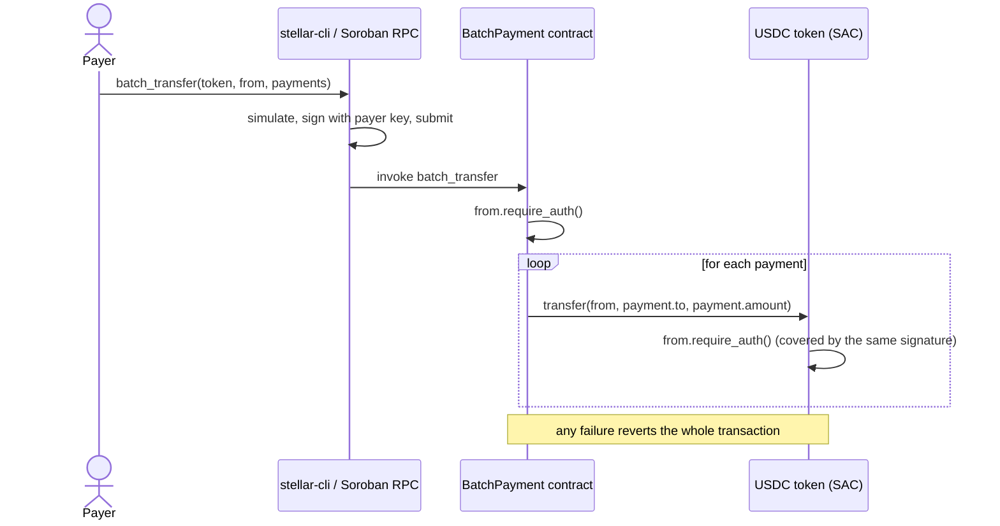

# Soroban Batch Payment Spike — Architecture

> **Status: minimal testnet prototype.** Technical spike for the grant
> application (Jira CP-968). Not production code, not audited, deployed only to
> Stellar testnet.

One Soroban contract call pays several recipients in a single atomic
transaction. The contract is deployed on Stellar testnet and was proven with a
real USDC payout to 4 recipients on 2026-10-25.

- Repository: <https://github.com/C-payments/batch-contract-stellar>
- README (build, tests, reproduction steps): [`README.md`](../README.md)
- Contract source: [`contracts/batch-payment/src/lib.rs`](../contracts/batch-payment/src/lib.rs)
- Tests: [`contracts/batch-payment/src/test.rs`](../contracts/batch-payment/src/test.rs)

## Components

| Component | Role |
|---|---|
| `BatchPayment` contract (Rust, soroban-sdk 29.0.1) | Stateless. Checks the payer's authorization, then calls `transfer` on the token once per recipient. |
| Token contract (any SEP-41 token) | Holds balances and moves funds. In the demo: the Stellar Asset Contract (SAC) of Circle testnet USDC. |
| Payer account | Signs the transaction; its signature authorizes `batch_transfer` and the nested token transfers. |
| Recipient accounts | Receive the token. For a classic asset such as USDC, each needs a trustline first. |
| stellar-cli 28.1.0 + Soroban RPC | Build, deploy and invoke: the CLI simulates the call, signs it with the payer key and submits it. |

## Contract interface

```rust
pub struct Payment {
    pub to: Address,
    pub amount: i128, // token base units; USDC has 7 decimals, 1 USDC = 10_000_000
}

pub fn batch_transfer(env: Env, token: Address, from: Address, payments: Vec<Payment>)
```

## Call flow



1. **Authorization first.** `from.require_auth()` runs before any transfer. The
   host accepts the call only if `from` signed this exact invocation, so nobody
   can use someone else's address as the payer.
2. **Transfers in a loop.** For every `{ to, amount }` pair the contract calls
   `token.transfer(from, to, amount)`. The token contract checks `from` again;
   the payer's signature covers these nested calls, so no `approve` step is
   needed.
3. **Atomicity.** If any transfer fails (insufficient balance, missing
   trustline), the whole transaction is reverted and no recipient is paid.

Covered by the unit tests: a successful batch pays every recipient and reduces
the payer's balance by the total; a call without the payer's authorization is
rejected and no balances change.

## Testnet deployment

Network: Stellar testnet (`Test SDF Network ; September 2015`), protocol 29.
Token: Circle testnet USDC, asset `USDC:GBBD47IF6LWK7P7MDEVSCWR7DPUWV3NY3DTQEVFL4NAT4AQH3ZLLFLA5`
([Circle docs](https://developers.circle.com/stablecoins/usdc-contract-addresses)).

### Contracts

| Contract | ID |
|---|---|
| Batch contract | [`CAFZNGNPQCPO2GYUWXJRNX3P3EB6H72JVJEFCXSGZTG264APPESIJNSV`](https://stellar.expert/explorer/testnet/contract/CAFZNGNPQCPO2GYUWXJRNX3P3EB6H72JVJEFCXSGZTG264APPESIJNSV) |
| USDC token (SAC) | [`CBIELTK6YBZJU5UP2WWQEUCYKLPU6AUNZ2BQ4WWFEIE3USCIHMXQDAMA`](https://stellar.expert/explorer/testnet/contract/CBIELTK6YBZJU5UP2WWQEUCYKLPU6AUNZ2BQ4WWFEIE3USCIHMXQDAMA) |

Batch contract wasm hash: `1937f798371fff8badc6f88701c0cfc242f337e69ade68296a671fb51c0d32c1`
(byte-identical to the wasm built from this repository with Rust 1.93.1 and stellar-cli 28.1.0).

### Transactions

| Step | Transaction hash | Ledger |
|---|---|---|
| Buy 50 USDC for XLM on the testnet DEX (payer setup) | [`f6ef4f626359f3abce3c1dd50147c3fae96d0c6a48774d0c2764f1c81732295f`](https://stellar.expert/explorer/testnet/tx/f6ef4f626359f3abce3c1dd50147c3fae96d0c6a48774d0c2764f1c81732295f) | — |
| Upload contract wasm | [`891c9ebb135a458c35b5fb24696760bf52bd87079614d52447939edf78ab676e`](https://stellar.expert/explorer/testnet/tx/891c9ebb135a458c35b5fb24696760bf52bd87079614d52447939edf78ab676e) | 5379430 |
| **Deploy contract** | [`0a0400024ae0e53896bcb0879c371f9b51329270e6e5fa80365dc62ad4644a70`](https://stellar.expert/explorer/testnet/tx/0a0400024ae0e53896bcb0879c371f9b51329270e6e5fa80365dc62ad4644a70) | 5379431 |
| **Batch transfer** | [`954492f3cb3a14a0e368fe7c87a4a6b2b918d3fca0c837f6a7b7a98d1a7aa5eb`](https://stellar.expert/explorer/testnet/tx/954492f3cb3a14a0e368fe7c87a4a6b2b918d3fca0c837f6a7b7a98d1a7aa5eb) | 5379435 |

### Accounts and demo result

| Role | Account | USDC received |
|---|---|---:|
| Payer | [`GA6PNWNR3SB3SE36PIQUCGEJJFYBEYOZRTT2U6DSCWTTFOPZBV44IOVQ`](https://stellar.expert/explorer/testnet/account/GA6PNWNR3SB3SE36PIQUCGEJJFYBEYOZRTT2U6DSCWTTFOPZBV44IOVQ) | — |
| Recipient 1 | [`GBQCZFYO4ZKMGJUE5GJGINKFDMDGOYDRKQRKFCP6BJFUB3SN7ZVR7E2P`](https://stellar.expert/explorer/testnet/account/GBQCZFYO4ZKMGJUE5GJGINKFDMDGOYDRKQRKFCP6BJFUB3SN7ZVR7E2P) | 1.00 |
| Recipient 2 | [`GDXW3WHJ2ZES66RULD2E27CVXU4HCP4L5D5OLQSICNGFHPUBWZTEAGYF`](https://stellar.expert/explorer/testnet/account/GDXW3WHJ2ZES66RULD2E27CVXU4HCP4L5D5OLQSICNGFHPUBWZTEAGYF) | 2.50 |
| Recipient 3 | [`GA5ZGO3HI5XKWT2VK7JJHL5WTJ5VNLMLHP6PK3VHPVEIXE4LBMIMIJXB`](https://stellar.expert/explorer/testnet/account/GA5ZGO3HI5XKWT2VK7JJHL5WTJ5VNLMLHP6PK3VHPVEIXE4LBMIMIJXB) | 0.75 |
| Recipient 4 | [`GCLZPK3MK6FJY2VOMYAH3C6UFGC37EJW3VXBBSSEU675AMO43B43IF3R`](https://stellar.expert/explorer/testnet/account/GCLZPK3MK6FJY2VOMYAH3C6UFGC37EJW3VXBBSSEU675AMO43B43IF3R) | 5.00 |

The batch transaction succeeded (Soroban RPC status `SUCCESS`, Horizon
`successful: true`). The USDC contract emitted four `transfer` events with
exactly the amounts above, and the payer's USDC balance went from 50.00 to
40.75 (−9.25).

Stellar testnet is periodically reset by SDF; if the links stop resolving, the
deployment can be reproduced with the steps in the [README](../README.md).

## Out of scope for the spike

Planned for the next grant milestone and intentionally not implemented here:

- allowance-based flow;
- custom events with payment references;
- batch size limit;
- contract pause;
- user interface.

Mainnet deployment and integration with C-Payroll payment flows are also out of
scope.
