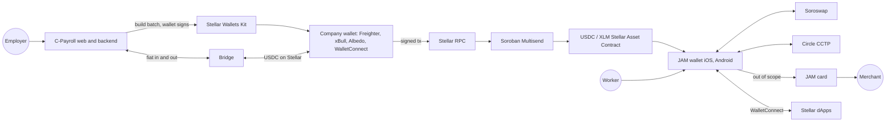
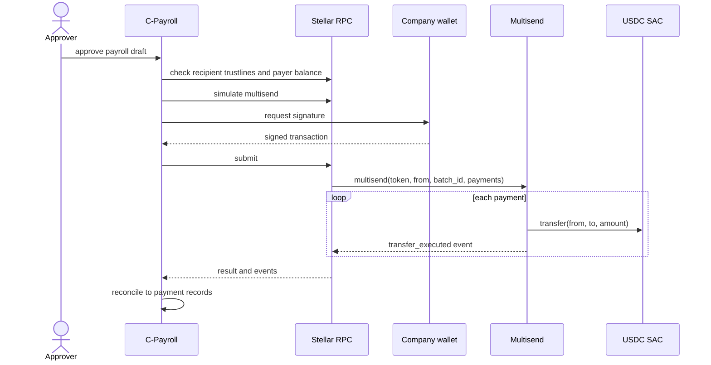
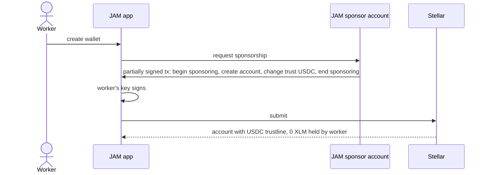

# C-Payroll + JAM on Stellar: Technical Architecture

Version 2, November 2026. This document is the technical architecture for our SCF #46 Integration Track submission ($95,000, 13 weeks of engineering, tranches 10/20/30/40, final-tranche metric of $100,000 USDC over 60 days).

Status labels used below: **Existing** = in production or in code today. **Spike** = running on Stellar testnet today. **T1 / T2 / T3** = built in this award.

## 1. Overview and scope

We connect two live non-custodial products into one payment path on Stellar. C-Payroll pays people; JAM is where they hold and spend what they were paid.

`Employer -> Bridge -> USDC on Stellar -> C-Payroll approval -> Soroban Multisend -> JAM wallet -> swap, hold or card top-up -> merchant`

**In this award:** the Soroban Multisend contract; Stellar in C-Payroll payout flows through Stellar Wallets Kit; Bridge fiat legs on Stellar; JAM sponsored accounts and trustlines, Soroswap swaps, Circle CCTP and WalletConnect for Stellar; AI agent tools for Stellar batch preparation; threat model and monitoring plan; open-source releases.

**Out of scope, at our own cost:** card top-up from a Stellar balance (USDC on Stellar through JAM's existing card-funding provider, enabled as configuration); both platforms' proprietary cores; the contract audit and its remediation (requested through the Soroban Audit Bank); marketing and user acquisition.

## 2. System context



## 3. Components

| Component | Status | Language | Location | Owner |
|---|---|---|---|---|
| EVM `BatchExecutor` (pattern source) | Existing | Solidity | private repository | Yaroslav |
| `BatchPayment` spike | Spike | Rust, soroban-sdk 29.0.1 | public `batch-contract-stellar` | Yaroslav |
| Multisend v1 (evolves the spike) | T1 | Rust | public `batch-contract-stellar` | Yaroslav |
| Bridge integration | Existing; Stellar route configured, verified in T2 (sandbox) and T3 (mainnet) | TypeScript | `payroll-crypto` | Yaroslav |
| Stellar Wallets Kit connection | T1 | TypeScript | `payroll-frontend` | Yaroslav |
| Multisend in payout flows, event reconciliation | T2 | TypeScript | `payroll-crypto`, `payroll-main` | Yaroslav |
| MCP tools for Stellar batch preparation | T2 | TypeScript | `payroll-crypto` | Yaroslav |
| JAM Stellar accounts, balances, payments, trustlines, history | Existing: wrapper over `Soneso/stellar-ios-mac-sdk` (iOS) and `org.stellar:wallet-sdk` (Android); JAM derives from Unstoppable Wallet (MIT, copyright preserved) | Swift, Kotlin | JAM apps | Paul |
| JAM WalletConnect/Reown sessions and multi-chain swap engine | Existing for EVM chains | Swift, Kotlin | JAM apps | Paul |
| JAM sponsored accounts and onboarding trustline | T1 | Swift, Kotlin | JAM apps; Swift module public in T3 | Paul |
| Soroswap, WalletConnect for Stellar, CCTP in JAM | T2 | Swift, Kotlin | JAM apps | Paul |
| Monitoring worker and reconciliation job | T3 | TypeScript | C-Payroll infrastructure, covering both footprints | Yaroslav, Paul |

## 4. Soroban Multisend specification

### 4.1 Today (Spike)

```rust
pub struct Payment { pub to: Address, pub amount: i128 }
pub fn batch_transfer(env: Env, token: Address, from: Address, payments: Vec<Payment>)
```

`from.require_auth()`, then `token.transfer(from, to, amount)` for each payment. Stateless. Any failed transfer reverts the whole call. Testnet contract `CAFZNGNPQCPO2GYUWXJRNX3P3EB6H72JVJEFCXSGZTG264APPESIJNSV`; results in Appendix A.

### 4.2 Multisend v1 (T1)

```rust
pub struct Payment { pub to: Address, pub amount: i128, pub reference: BytesN<32> }

pub fn __constructor(env: Env, admin: Address, max_batch_size: u32)
pub fn multisend(env: Env, token: Address, from: Address, batch_id: BytesN<32>, payments: Vec<Payment>)
pub fn pause(env: Env)                         // admin
pub fn unpause(env: Env)                       // admin
pub fn set_max_batch_size(env: Env, max: u32)  // admin
pub fn admin(env: Env) -> Address              // read-only
pub fn is_paused(env: Env) -> bool             // read-only
pub fn max_batch_size(env: Env) -> u32         // read-only
```

| Topic | Rule |
|---|---|
| Authorization | `from.require_auth()`. The payer's signature covers the nested token transfers, so there is no `approve` step and no standing allowance (decision in 5.1) |
| Custody | The contract never holds balances: funds move directly from payer to recipients |
| Validation | Non-empty; length not above `max_batch_size`; each `amount > 0`; checked sum. The whole batch is validated before the first transfer |
| Replay protection | Each `(from, batch_id)` pair is stored once in persistent storage, as in the EVM `DuplicateBatchId` check. Keying by payer means nobody can block a company's batch by submitting their own batch with the same id first. The entry's TTL is extended to 30 days on write, and the contract instance TTL to 30 days on every state-changing call. A failed batch leaves its `batch_id` unused. C-Payroll also refuses to resubmit an executed `batch_id` from its own records, so an expired storage entry cannot cause a double payout |
| Events | `transfer_executed(batch_id, token, from, to, amount, reference)` per payment, with `token`, `from` and `to` as topics; `batch_executed(batch_id, token, from, count, total)` per batch, with `token` and `from` as topics; `paused`, `unpaused` and `max_batch_size_set(max_batch_size)` for admin actions, with `admin` as topic |
| Batch limit | `max_batch_size` is set at deployment and can be lowered or raised by the admin; zero is rejected. Its value comes from test submissions of the deployed contract, not from simulation alone: simulation does not enforce the per-transaction contract events size, which is the binding limit. Each USDC payment emits about 620 bytes of events (the token's `transfer` and `transfer_executed`), so with testnet's 16,384-byte limit a batch holds 25 payments. The mainnet value is measured the same way at deployment (3.1). C-Payroll simulates every batch before signing, budgets instructions above the simulated value (applied transactions used up to 125 more instructions than simulated on testnet), and splits a payroll run above the limit into several Multisend transactions |
| Pause | Blocks `multisend` only; no funds are held, so pausing never locks funds |
| Admin | 2-of-3 multisig account: three signers of weight 1, master key weight 0, low, medium and high thresholds of 2. Soroban checks an account's medium threshold; the admin is the transaction source, so the transaction signatures carry the authorization. Admin powers are limited to pause, unpause and the batch limit: the admin cannot move funds or change recipients. The admin address is set in the constructor and cannot change, so signers are rotated on the account itself; a high threshold of 2 lets two signers replace a lost third |
| Upgrade | The contract is not upgradable: it has no function that replaces its wasm. Fixes ship as a new deployment, and the new contract ID is registered as a footprint update |
| Fee | None. The Stellar version charges no contract fee |

| Error | Meaning |
|---|---|
| `InvalidBatchSize` | Empty batch or above the limit |
| `InvalidAmount` | Amount not above zero |
| `Overflow` | Checked sum overflowed |
| `DuplicateBatchId` | Batch already executed |
| `Paused` | Contract paused |

### 4.3 Compared with EVM BatchExecutor

| | EVM `BatchExecutor` | Multisend v1 |
|---|---|---|
| Entry | `batchTransfers(transfers, batchId)` | `multisend(token, from, batch_id, payments)` |
| Tokens in a batch | Mixed, including native | One token per batch |
| Spend authorization | ERC-20 `approve` | `require_auth` authorization tree, no allowance |
| Replay | `executedBatches` | `(from, batch_id)` in persistent storage |
| Limits | `maxBatchSize` | `max_batch_size` |
| Pause | Yes | Yes |
| Fee | Native fee, capped | None |
| Reentrancy | `nonReentrant` | Soroban disallows contract re-entry; Multisend calls only the token contract passed as `token`, and C-Payroll restricts it to the USDC and XLM Stellar Asset Contracts |

## 5. Design decisions

### 5.1 Direct authorization rather than allowance

Alternative considered: SEP-41 `approve` plus `transfer_from`. Direct authorization needs one signature and one transaction, leaves no standing allowance that could be abused later, and is already proven on testnet by the spike. Trade-off: the authorization tree grows with each recipient and counts toward transaction size, so it lowers the maximum batch size. On testnet the per-transaction events size binds first (4.2). Both are handled by the measured batch limit and automatic splitting.

Wallet constraint: `from` is the transaction source account, so the transaction signature carries the authorization. This works with wallets that implement only `stellar_signXDR` and `stellar_signAndSubmitXDR`, including JAM over WalletConnect, and needs no `stellar_signAuthEntry`. Signing Multisend from JAM is tested as part of deliverable 2.4.

### 5.2 Soroban contract rather than classic batching or SDP

A classic transaction is capped at 100 operations and has no single on-chain surface with a per-payment reference and per-payment events. The Stellar Disbursement Platform runs its own disbursement and recipient onboarding flow, while C-Payroll already owns approvals, payee records and self-custody signing. C-Payroll needs only the on-chain primitive.

### 5.3 Stellar Wallets Kit

One integration covers Freighter, xBull, Albedo and WalletConnect wallets. The wallet only signs.

### 5.4 Soroswap for swaps

Ready-made routing across Stellar liquidity through the Soroswap Routing API, instead of building a router.

### 5.5 Circle CCTP for inbound USDC

Native burn and mint with no wrapped asset. Stellar is CCTP domain 27, supports Standard Transfer, and inbound transfers mint through `CctpForwarder`.

## 6. Flows

### 6.1 Payroll run (T1, T2)



If the simulation shows the run exceeds the batch limit, C-Payroll splits it into several batches, each with its own `batch_id`, and the approver signs each one.

### 6.2 Recipient onboarding (T1)



The trustline is created during onboarding, before the first payout, because a payout to a recipient without a USDC trustline reverts the whole batch. JAM operates a dedicated sponsor account, funded with XLM by JAM; its balance is monitored (section 11). Recipients who use other Stellar wallets must open a USDC trustline themselves. C-Payroll's pre-check flags any recipient without one before the batch is signed, so the approver can remove or onboard them.

### 6.3 Bridge in and out (T2 in sandbox, T3 on mainnet)

Fiat in: the company funds through Bridge, and USDC arrives at the company's Stellar address, which holds a USDC trustline. Fiat out: the company sends USDC on Stellar to a Bridge liquidation address and receives fiat on its external account; Bridge offers a memoless address for Stellar. Bridge sandbox does not move funds and is not connected to testnet, so T2 verifies API objects and statuses shown in C-Payroll. Real settlement is verified on mainnet in T3 with a small amount in each direction.

### 6.4 Swap (T2)

JAM requests a route from the Soroswap Routing API, shows the quote and the slippage limit, the worker signs, and the result is recorded in history.

### 6.5 CCTP (T2)

Burn on the EVM source chain, wait for Circle's attestation, then mint on Stellar through `CctpForwarder`. The recipient holds a USDC trustline from onboarding. USDC precision differs between EVM chains and Stellar, so amounts are converted explicitly. While attestation is pending, JAM shows the transfer as in progress.

### 6.6 WalletConnect signing (T2)

Namespaces `stellar:pubnet` and `stellar:testnet`; methods `stellar_signXDR` and `stellar_signAndSubmitXDR`. Every request needs confirmation; sessions expire and can be revoked. The wallet is a signing device only, so SEP-10 is not needed: C-Payroll users sign in through C-Payroll's own identity provider, and a signed transaction proves account control. If an anchor flow later needs SEP-10, the C-Payroll backend establishes it with its own account. The WalletConnect specification for Stellar is still under review, so method names may change; JAM follows the current specification and updates if it changes.

### 6.7 MCP agent (T2)

The agent reads balances and prepares a batch as a draft. It has no signing ability. Execution goes through flow 6.1 after a human approves the draft.

## 7. Account and key model

| Transaction | Signs | Pays fee | Key held by |
|---|---|---|---|
| Multisend | Company wallet | Company | Company's own wallet |
| Sponsored onboarding | Sponsor and worker | Sponsor | Sponsor key in HashiCorp Vault, used only by the JAM sponsor service; worker key on the worker's device |
| Swap, CCTP, payment in JAM | Worker | JAM sponsor through a fee-bump transaction, so the worker needs no XLM | Worker's device: Secure Enclave or Android Keystore, biometric gate, no key export |
| Contract admin | 2-of-3 multisig (thresholds 2, master key weight 0) | Admin | Three signers from the C-Payroll leadership on separate hardware wallets |

C-Payroll holds no customer keys or funds. Authorization inside C-Payroll (who may approve a payroll) stays off-chain in its existing role model with multi-step approvals.

## 8. Data and reconciliation

Source of truth: contract events read through RPC `getEvents` with a stored cursor. RPC keeps events for a limited window, so ingestion runs continuously and stores every event in C-Payroll's database; a missed range is recovered from transaction results by hash. The contract is open to any caller, so ingestion keeps only events whose `from` is a company wallet linked in C-Payroll and whose `token` is the USDC or XLM Stellar Asset Contract. Events are matched to payment records on `from`, `batch_id` and `reference`, idempotently by transaction hash and event index. A mismatch raises an alert (section 11). Activity is exported as CSV.

## 9. Infrastructure

| Area | Design |
|---|---|
| Environments | Testnet and mainnet, each with its own contract ID and configuration |
| RPC | SDF testnet RPC for development; on mainnet, two independent RPC providers with automatic fallback |
| Secrets | Sponsor key and service credentials in HashiCorp Vault, already used by C-Payroll; admin signers on hardware wallets, never on servers |
| CI | GitHub Actions on every push: tests with at least 90% line coverage enforced (`cargo llvm-cov --fail-under-lines 90`), `stellar contract build` and the wasm hash |
| Releases | Reproducible builds: Rust pinned in `rust-toolchain.toml`, stellar-cli pinned in CI. A version tag publishes a GitHub release with the wasm and its hash (spike hash in Appendix A) |

## 10. Security

Draft STRIDE model; the full threat model is deliverable 2.7.

| Category | Threat | Mitigation |
|---|---|---|
| Spoofing | Wrong wallet linked to a company | Existing role model; a wallet is linked only after it signs a transaction that proves account control |
| Tampering | Recipients or amounts changed before signing | Approved draft compared to the simulated call; the wallet shows the call before signing |
| Repudiation | Disputed payout | Per-payment events; records keyed on `batch_id` and `reference` |
| Information disclosure | Payee data on-chain | Only an opaque `reference` goes on-chain |
| Denial of service | Oversized batch, RPC outage, griefing recipient | Batch limit; RPC fallback; trustline pre-check |
| Elevation of privilege | Admin key compromise | 2-of-3 multisig; admin can only pause and change the limit |
| Elevation of privilege | WalletConnect session signs beyond user intent | Per-request confirmation, scoped namespaces, session expiry and revocation |
| Tampering | Adverse swap route | Slippage bounds; rate deviation monitor |
| Information disclosure | Key extraction from a device | Secure Enclave or Keystore; no key in logs |

**AML:** C-Payroll screens every crypto payout address before execution. Stellar is added to the screening map before mainnet in T3, using a screening provider that covers Stellar addresses. Until then Stellar payouts are limited to pilot customers' known payees.

**Assessment:** C-Payroll's EVM contract and core services had a security assessment by Tetracode in June 2026: https://tetracode.io/cpayroll-security-assessment/. It does not cover Multisend, which goes to the Soroban Audit Bank at the end of T2.

**Mainnet before audit completion:** Multisend runs on mainnet with an enforced batch limit and pilot customers only until audit findings are remediated.

## 11. Monitoring plan (draft)

The final plan is deliverable 2.7; monitors go live in 3.4.

| Monitor | Trigger | Response |
|---|---|---|
| Unexpected recipient | Event from a linked company wallet that is not in an approved batch | Critical: pause contract, investigate |
| Reconciliation drift | Event total differs from batch total | High |
| Admin action | `pause`, `unpause` or limit change not in the change log | High |
| Event gap | No ingestion while batches are pending | High |
| Failed invocations | Above the baseline measured during testnet operation | Medium |
| Sponsor balance | Below 30 days of expected onboarding | Medium |
| WalletConnect session | Signed volume above baseline, or a signature from an inactive session | Critical: revoke sessions |
| Swap rate | Deviation from the reference rate above 2% | High |
| CCTP legs | Burn and mint amounts differ beyond tolerance | High |

Monitors consider only events whose `from` is a company wallet linked in C-Payroll: the contract is permissionless, so calls by other accounts are not incidents. Populated thresholds are shared privately, as Stellar's monitoring template advises; the structure and method are public.

## 12. Failure modes

| Failure | Behaviour | Recovery |
|---|---|---|
| Missing trustline | Whole batch reverts | Pre-check flags the recipient before signing; remove or onboard |
| Insufficient balance | Reverts, no funds moved | Fund and resubmit |
| Resource limit exceeded | `max_batch_size` keeps batches under the events size limit, which simulation does not check; a batch above it fails simulation with `InvalidBatchSize` | Split automatically into smaller batches |
| Repeated submit | `DuplicateBatchId` | Find the original transaction and its events for `(from, batch_id)` before marking the batch executed |
| RPC outage | Submit or status unknown | Fallback RPC; query by hash before any retry |
| Expired transaction | Not applied | Rebuild and re-sign |
| CCTP mint fails | Burn done, mint pending | Retry mint with the attestation; show pending |
| Bridge failure | Status reported by Bridge | Show status; no on-chain retry |

## 13. Testing strategy

Contract: unit and integration tests covering limits, replay, pause, reverts and authorization, with at least 90% line coverage reported in CI. Testnet end-to-end runs for each flow in section 6. Manual QA on iOS and Android before each release.

## 14. Delivery plan

| # | Deliverable | Section | Weeks |
|---|---|---|---|
| 1.1 | Multisend on testnet | 4 | 1-3 |
| 1.2 | Batch signed from C-Payroll | 5.3, 6.1 | 2-4 |
| 1.3 | JAM wallet with 0 XLM receives USDC | 6.2 | 1-4 |
| 1.4 | C-Payroll to JAM integration: one run pays 20 JAM wallets | 6.1, 6.2 | 4 |
| 2.1 | Three payout flows, reconciliation | 6.1, 8 | 5-8 |
| 2.2 | Bridge in sandbox | 6.3 | 5-6 |
| 2.3 | Soroswap | 6.4 | 5-7 |
| 2.4 | WalletConnect | 6.6 | 6-7 |
| 2.5 | CCTP | 6.5 | 7-8 |
| 2.6 | AI agent with approval | 6.7 | 8 |
| 2.7 | Threat model, monitoring plan, Audit Bank application | 10, 11 | 6-8 |
| 3.1 | Mainnet with batch limit, footprint, readiness review | 4, 10, 15 | 9-10 |
| 3.2 | Customer batches, Bridge settlement on mainnet | 6.1, 6.3 | 9-12 |
| 3.3 | JAM release | 6.2-6.6 | 10-12 |
| 3.4 | Monitors live | 11 | 10-12 |
| 3.5 | Open-source releases | 16 | 11-13 |
| 3.6 | Production QA fixes | 13 | 12-13 |

## 15. On-chain footprint and metric

| Element | Commitment |
|---|---|
| Metric | Cumulative USDC volume disbursed through the registered Multisend contract on mainnet, counted from `transfer_executed` events whose `token` is the USDC Stellar Asset Contract |
| Threshold | $100,000 |
| Window | 60 consecutive days from the Multisend mainnet deployment, ending no later than week 18 |
| Footprint | Multisend mainnet contract ID; JAM sponsor account(s); the USDC asset |
| Excluded | Our own team's payroll, self-transfers and test batches |

## 16. Open source

| Item | When | Licence |
|---|---|---|
| Multisend contract, tests, documentation, integration guide | Public from T1, tagged release in 3.5 | Apache-2.0 |
| JAM Swift Stellar wallet module (account sync, trustlines, sponsored reserves) | Tagged release in 3.5 | Apache-2.0, keeping the MIT notice for code derived from Unstoppable Wallet |

Remain closed: both platforms' cores; JAM's Kotlin layer, since `org.stellar:wallet-sdk` already fills that role on Android; product wiring; the monitoring worker and populated thresholds.

## Appendix A. Spike results

Network: Stellar testnet. Tools: Rust 1.93.1, soroban-sdk 29.0.1, stellar-cli 28.1.0.

| Item | Value |
|---|---|
| Contract | `CAFZNGNPQCPO2GYUWXJRNX3P3EB6H72JVJEFCXSGZTG264APPESIJNSV` |
| Wasm hash | `1937f798371fff8badc6f88701c0cfc242f337e69ade68296a671fb51c0d32c1` |
| Deploy tx | `0a0400024ae0e53896bcb0879c371f9b51329270e6e5fa80365dc62ad4644a70` |
| Batch tx | `954492f3cb3a14a0e368fe7c87a4a6b2b918d3fca0c837f6a7b7a98d1a7aa5eb` |
| Result | 4 recipients, 9.25 USDC, successful; fee charged 19,557 stroops (0.0019557 XLM) |

The production batch limit is set from test submissions of the deployed Multisend v1 contract (section 4.2). Because C-Payroll splits larger runs automatically, the limit affects how many transactions a payroll run needs, not whether it can run.

## Appendix B. References

SEP-41; CAP-33; [Stellar resource limits and fees](https://developers.stellar.org/docs/reference/resource-limits-fees); [Circle CCTP supported chains and domains](https://developers.circle.com/cctp/concepts/supported-chains-and-domains.md); [WalletConnect Stellar RPC](https://docs.walletconnect.network/wallet-sdk/chain-support/stellar).
